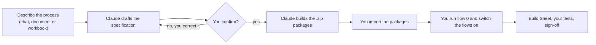

# Power Automate Builder: User Guide

Skill version 1.0 · 20/11/2026 · Author: Ahmed SERAFY, Perficio Limited · Co-authored by Claude Code

Describe a process to Claude, confirm the specification it writes back, and receive import packages that create SharePoint lists and Power Automate flows. The flows run on your own Microsoft 365 connections. This guide covers skill version 1.0.

## What it does and when to use it

The skill turns a described process into two things: the SharePoint lists that hold the data, and the Power Automate cloud flows that move it. You stay the owner. Flows run on your connections, with your permissions, and emails leave from your mailbox.

Use it for:

- Approvals: purchase requests, leave, document sign-off, exceptions.
- Notifications and reminders: new item alerts, due dates, weekly digests.
- Registers and trackers: a list with a status that moves through stages.
- Hand-offs between people or departments.

Do not use it for:

- Desktop (RPA) flows, Power Apps screens or Dataverse solutions.
- Processes that need premium connectors, unless you hold the licence and approval.
- Integrations with systems outside Microsoft 365, such as an ERP or finance system. Raise those with your IT team.

Every build produces a **Build Sheet**. It records what was built, how to install it, how to test it and what remains open. Keep it as the change record. You also receive an Install Checklist. This is a page with a tick box for every step, written for your build.

## How a build runs



*Build flow: 6 steps, 1 decision, 1 output.*

You describe, Claude drafts, you confirm. Only then does Claude build the import packages. You import them yourself, and every build ends with the Build Sheet and your own tests.

## Before you start

Have these ready. The site URL is the one item Claude cannot work without.

| You need | Why | Where to check |
| --- | --- | --- |
| The skill enabled in Claude | Claude follows it automatically in this project | Customize, then Skills |
| Code execution and file creation turned on | Claude builds the packages with scripts | Settings, then Capabilities |
| The SharePoint site URL | Lists are created there and flows point to it | Open the site and copy the address up to `/sites/Name` |
| Edit permission on that site | Needed to create lists | Site members have it by default |
| Access to Power Automate | To import and run flows | make.powerautomate.com, sign in with your work account |
| Connections for SharePoint, Approvals and Outlook | Flows run on them | Power Automate, then Connections |
| A co-owner | Keeps the flow alive when you are away | Agree a name before you build |
| A failure alert address | Receives an email when a run fails | Usually your own address |
| Your organisation's settings | Time zone for schedules, date format for messages, currency for amount columns, and the approval authority for approvals | Claude asks for any the flow needs, unless your team has already set them in the skill |

Standard connectors need no extra licence beyond Microsoft 365. Premium connectors do; Claude will flag them as open points and will not design around them silently.

## Three ways to describe your process

The intake workbook gives the most repeatable result. Choose by the size of the process.

| Input | Best for | What Claude does | Repeatability |
| --- | --- | --- | --- |
| Chat description | Small flows, up to about five steps | Asks one round of questions, then writes the specification | Lower |
| Process document (procedure, SOP, policy, flowchart) | A process already written down | Extracts trigger, people, data, decisions and outcomes, citing sections. Lists gaps and contradictions as questions | Medium |
| Automation Intake Workbook (Excel) | Anything you will maintain, audit or rebuild | Converts it by script, the same way every time, and reports every assumption | High |

Two rules apply to every input:

1. Claude builds nothing until you confirm the specification.
2. When a document contradicts itself, Claude asks. It does not choose for you.

For a large documented process, ask Claude to fill the workbook from the document. Correct the workbook, then have it converted. The workbook then stays the single source of truth.

## Filling in the Automation Intake Workbook

Fill the sheets left to right. Blue rows are a worked example; overwrite or delete them.

| Sheet | One row per | Key points |
| --- | --- | --- |
| Process | (single values) | Name, department, owner, co-owner, site URL, time zone, date format, currency, failure alert email, purpose. Blank settings fall back to UTC, `yyyy-MM-dd` and the site's own currency |
| Lists | List | Give a URL name without spaces. Mark "Already exists?" Yes for lists you have |
| Columns | Column | Internal name has no spaces and never changes. List the columns of existing lists too |
| Flows | Flow | Number them 1, 2, 3. Pick the trigger from the drop-down |
| Steps | Step | Number within each flow. For a step inside a Condition, give the condition's step number and the branch, Yes or No |

**Step types:** Start approval and wait (first to respond, or everyone), Condition, Update item, Create item, Send email, Post to Teams channel, Get manager, Delay, Custom.

**Tokens** let you refer to data without writing expressions. Use them in any text, To, Item ID or Field values cell.

| Token | Gives |
| --- | --- |
| `{Trigger.ID}`, `{Trigger.Title}`, `{Trigger.Link}` | The item that started the flow |
| `{Trigger.Amount}` (any internal column name) | That column. A Choice gives its value; a Person gives the email |
| `{Trigger.Approver.Name}` | A Person column's display name |
| `{Trigger.CreatedBy.Email}`, `{Trigger.CreatedBy.Name}` | Who created the item |
| `{Approval.Outcome}`, `{Approval.Comments}`, `{Approval.Responder}` | The latest approval step before this one. Outcome is Approve or Reject |
| `{Manager.Email}`, `{Manager.Name}` | The latest Get manager step before this one |
| `{Today}`, `{Now}`, `{Owner.Email}` | Date, local date and time in your date format, the process owner |

**Formats**

- Field values: `Status=Approved; DecisionDate={Today}`
- Condition and Trigger condition: `{Trigger.Amount} | greater than | 50000`
- Operators: equals, not equals, greater than, greater or equal, less than, less or equal, contains, starts with, is empty, is not empty
- Delay: write the duration in the Subject cell, for example `2 Day`

**What the converter adds for you:** the correct write format for each column type, a failure alert with a link to the failed run, flow names in the standard pattern, and a warning if a flow would trigger itself in a loop.

**Custom steps.** Anything outside the drop-down goes in as Custom, with the requirement in Notes. Claude writes that step by hand and flags it for your review.

## What you receive

The skill has one output: import packages for Power Automate. Nothing changes in your tenant until you import them yourself.

| File | What it is |
| --- | --- |
| `... - 0 Provision lists.zip` | Creates the SharePoint lists and columns. Import and run it first |
| `... - 1 <name>.zip`, and so on | One package per flow, numbered in import order |
| Install Checklist | A page with a tick box for every import, set-up and test step, written for your build |
| Build Sheet | The record of what was built, how to test it and what remains open |

Claude never signs in to your tenant and never builds there directly. You import the packages with your own account. Claude never asks for a password or an MFA code.

The Microsoft 365 connector in Claude chat can find sites and read documents. It cannot create lists or flows.

## Importing, switching on and creating the lists

Import the packages in number order. Flow 0 creates the lists, so it goes first. Your Install Checklist carries these same steps with your real file names, connections and lists, and it remembers your ticks. Work from the checklist; the steps below are the general version.

**Import each package**

1. Sign in to make.powerautomate.com. Check the environment name at the top right.
2. Select **My flows**, then **Import**, then **Import Package (Legacy)**.
3. Select **Upload** and choose the .zip. Do not unzip it first.
4. For each connection row, choose **Select during import**, pick your connection, then **Save**.
5. Select **Import**, then **Open flow**.

**Create the lists (flow 0)**

1. Open flow 0 and select **Run**, then **Run flow**.
2. Open the run. Every list step should be green.
3. Check the lists on the SharePoint site. Then delete flow 0 or leave it switched off.

Flow 0 skips lists that already exist. On a second run, steps named `Add_...` show red for columns that already exist. That is expected.

**Finish each flow**

1. Open the flow. Check each SharePoint action shows its site and list. Reselect from the drop-down if one shows an error.
2. Set the values listed under "Values to set after import" in the Build Sheet.
3. **Save** and clear any Flow checker errors.
4. On the flow's details page, select **Turn on**. Imported flows can arrive switched off.
5. **Share** the flow with your co-owner.

## Testing and sign-off

A flow is not finished until the Build Sheet test cases pass. Packages are checked for structure before delivery, but only your import and a test run prove they work.

- [ ] Run each test case in the Install Checklist or Build Sheet, using yourself as approver and recipient.
- [ ] Test both branches of every condition, including rejection.
- [ ] Test one failure on purpose, for example a missing approver, and confirm the failure alert arrives.
- [ ] Check run history after each test. SharePoint triggers poll, so allow one to two minutes.
- [ ] Replace test people with the real ones only after all cases pass.
- [ ] File the Build Sheet with the test results as the change record.

## Troubleshooting

Paste the exact error text to Claude in the same chat. It usually names the failing action. If an import fails but the page offers "Save as a new flow", use that link. It opens the flow in the designer, where you can save it and carry on.

| Symptom | Likely cause | Fix |
| --- | --- | --- |
| No "Import Package (Legacy)" option | The environment requires solutions | Use the default environment, or ask the Power Platform admin to allow package import |
| "The package is invalid" | The .zip was unzipped and zipped again | Download the original file again and upload it untouched |
| Import button stays grey | A connection row is not set | Set every row under "Select during import" |
| Blocked by DLP policy | A policy forbids that connector combination | Ask the admin, or ask Claude to redesign with allowed connectors |
| "List not found" in an action | The list name differs, or contains a full stop | Reselect the list in the action |
| 400 error on Update item | A required column is missing, or a Choice value does not match exactly | Compare the value with the column's choices |
| 403 error | The connection owner lacks permission on the site | Grant Edit on the site or list |
| Flow runs repeatedly | It updates the list that triggers it | Add the trigger condition from the Build Sheet |
| Approval never arrives | The Approver column is empty or not a Person column | Fill the column; check the internal name |
| Emails come from the wrong person | Flows send as the connection owner | Use a shared mailbox action; ask Claude to change it |

## Ground rules

You own what you build. These rules keep flows supportable and auditable.

- **Ownership.** Every flow has a named owner and a co-owner. Flows stop working when the connection owner's account is disabled.
- **Naming.** Flows follow `Department - Process - n What it does`. Lists use plain titles and URL names without spaces.
- **Connectors.** Standard connectors only, unless a premium licence and DLP approval are confirmed.
- **Data.** Keep personal or confidential data out of lists unless the list permissions are restricted. Flag external recipients before building.
- **Routing rules live in lists, not in flows.** Approvers and thresholds sit in a reference list the business can edit.
- **Authority.** An approval flow must follow your organisation's approved approval authority, such as a delegation of authority or an approval matrix. The flow records a decision; it does not create authority.
- **Changes.** Change the workbook or specification first, rebuild, retest, and update the Build Sheet version.

Claude will not: ask for passwords, alter or delete existing flows or lists you did not name, send test messages to real approvers without your say, or present an unverified parameter as verified.

## Prompts to copy

Start a new chat in the project for each process. The helper page ([`power-automate-builder-helper.html`](power-automate-builder-helper.html)) builds these for you. Download it and open it in your browser.

**From a description**

```
Automate this process with the Power Automate Builder skill.
Site: https://<tenant>.sharepoint.com/sites/<Site>
Process: <what starts it, who does what, what is recorded, who is told>
Owner: <you>. Co-owner: <name>. Failure alerts to: <email>.
Time zone: <zone>. Date format: <format>. Currency: <code>.
Write the specification first and wait for my confirmation.
```

**From a document**

```
The attached procedure describes our <process>. Extract the automatable steps,
cite the sections, list gaps and contradictions as questions, and fill the
Automation Intake Workbook for me to review. Do not build yet.
```

**From a filled workbook**

```
Convert the attached intake workbook. Show me the specification and every line
of the conversion report. After I confirm, build the import packages, the Install Checklist and the Build Sheet.
```

**When something fails**

```
Flow "<name>" failed at action "<action>" with this error: <paste>.
Explain the cause and give me the corrected package or the exact change to make.
```

## Known limits and open points

- The skill's packages are validated by script before delivery. A one-step Outlook flow package has been imported and run in a live tenant. The list provisioning flow, SharePoint triggers and approvals are not yet tested in a live tenant.
- Loops over many items, multi-value columns and Teams channel IDs need hand-finishing. The conversion report names each case.
- Child flows and solution-aware features are outside the package route.
- SharePoint triggers poll. Expect a delay of up to a few minutes.
- Approvals expire after 30 days.
- Confirmed in the pilot tenant on 19/11/2026: Import Package (Legacy) is available in the default environment. Check your own environments before relying on it.
